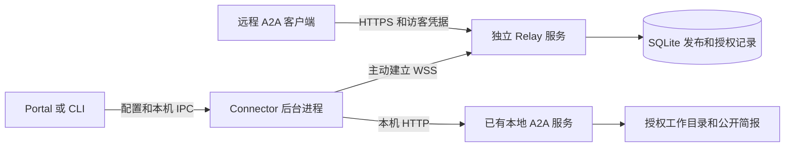

# A2A 公网中继架构设计草案

更新日期：2026 年 10 月 30 日。状态：确认范围已完成本地实现；部署待后续决定。配套文档：[关键流程伪代码](a2a-relay-pseudocode.zh-CN.md)、[实际实现与测试](a2a-relay-implementation.zh-CN.md)。

用户在现有 Talk2MyAgent Portal 中选择“公网中继”，默认使用预置 Relay，也可选择自定义 host；后台自动启动 Connector、注册发布实例并建立连接，成功后显示公网地址和“复制访客邀请指令”。默认流程不要求最终用户填写 Relay 地址、本地端口、设备凭据或配对码。关闭公网发布只停止转发，本地 agent 继续运行。

本方案新增独立开源 Relay 服务，复用现有 Portal 和 CLI。Connector 随管理工具安装，由管理工具启动，不进入 DSH 插件的运行生命周期。以下保留设计约定；已实现内容和首版调整以实现记录为准，npm 发布和线上部署仍需后续决定。

## 1 产品范围和关键决定

| 决定 | 首版方案 | 原因与限制 |
| --- | --- | --- |
| 本地入口 | 复用 Portal 和 `a2a-host` CLI | 不新增完整管理后台 |
| 访客出站调用 | 复用已有 A2A 技能和访客 CLI | 补充中继地址兼容，不新增 MCP bridge |
| Connector 生命周期 | 每个本地 agent 最多一个独立后台进程 | 关闭页面或 Portal 进程不影响发布；显式关闭发布才停止 |
| 云端 | 独立开源 Relay，单实例 | 部署简单；更新或故障时连接会中断，需要重连 |
| 默认接入 | 维护者预置 Relay 入口，同时支持用户配置自定义 host | 两种入口共用自动 agent 注册接口；默认用户不填地址 |
| 发布授权 | 后台自动生成设备凭据并绑定发布实例 | 无需手动配对；设备管理权限与访客聊天权限分开 |
| 邀请访客 | 复用现有邀请指令，自动填入公网地址、完整 Card URL 和所选访客凭据 | 不让用户手工改命令，不把设备发布令牌复制给访客 |
| 对外接口 | A2A 1.0 JSON-RPC、Agent Card、SSE | 先验证 DSH；不宣称兼容所有 A2A 版本和绑定方式 |
| 本地业务 | 原有聊天、工作目录读取、公开简报 | 中继不调用模型、不改变工具权限、不同步整个工作目录 |
| 云端地址 | 单域名下的发布路径 | 自有客户端需支持完整 Card URL；泛域名作为后续可选模式 |
| Agent Card | Connector 适配公开地址 | 开启发布不要求重启 DSH；签名卡片和不支持的卡片结构拒绝发布 |
| 开机自启 | 首版不安装系统服务 | 网络恢复自动重连；电脑重启或 Connector 崩溃后由 Portal/CLI 重新启动 |

首版不包含访客网页聊天、agent 市场、计费、多节点高可用、离线消息队列、任意 TCP 隧道、文件上传和 A2A push notification。闭源 agent 的入站适配暂不做，也不新增 API/SDK/CLI/MCP 转 A2A 的适配框架。

## 2 系统关系



WSS 连接由 Connector 主动发起，请求可以沿该双向连接从 Relay 传回本机。客户端仍使用普通 A2A HTTP 接口，不需要安装 Connector。

本地请求：`本机客户端 → 本地 /a2a → agent`。

公网请求：`远程客户端 → Relay → 已建立的连接 → Connector → 本地 /a2a → agent`。

Relay 和 Connector 负责网络传输。A2A 方法、任务、会话、访客权限和模型执行仍由原本的 A2A 服务负责。TLS 保护两段网络连接，但 Relay 能看到经过它的内容；本方案不提供端到端加密。

## 3 代码组织和现有接入点

拟新增的包名和仓库名仅用于设计，尚未注册或创建。

```text
Talk2MyAgent/
  packages/a2a-host/              现有 Portal 和发布方 CLI
  packages/a2a-skill/             现有访客 CLI，补充 Card URL 发现
  packages/a2a-connector/         新增后台进程、管理客户端、卡片适配
  packages/a2a-relay-protocol/    新增消息类型、校验和协议测试向量

a2a-relay-server/                新的独立开源仓库
  src/server/                   公网 HTTP、WSS 和授权
  src/store/                    SQLite
  src/admin/                    部署者管理 CLI 和私有 IPC
  deploy/                       Docker 和 HTTPS 代理示例
```

协议包供两端使用，不依赖 DSH。Connector 提供可独立运行的 CLI，也供 `a2a-host` 调用。云端仓库只依赖协议包，不导入 Portal 或本地 agent 的代码。协议使用显式版本协商，不能靠 npm 版本相同来假定兼容。

Relay Server 单独建仓库；Connector 放在现有 Portal 仓库的独立包中，不写进 React 页面组件。它的核心不导入 DSH SDK、Portal 页面或特定厂商 SDK，因此可以独立安装和启动。当前只连接已有的、符合本方案约束的 A2A 接口，先验证 DSH；其他原生 A2A 服务可独立验证兼容性，无需先建设厂商适配框架。

| 当前代码 | 当前能力 | 计划改动 |
| --- | --- | --- |
| `Talk2MyAgent/packages/a2a-host/src/dsh.ts` | DSH 后台运行及 PID 记录 | 参考启动方式，新 Connector 增加进程锁、IPC 和身份核验，不能照搬仅 PID 存活判断 |
| `Talk2MyAgent/packages/a2a-host/src/server.ts`、`src/cli.ts` | 本地管理 API 和命令 | 公网发布的配置、开启、关闭、状态；停止 agent 时先停止它的发布 |
| `Talk2MyAgent/packages/a2a-host/web/src/Wizard.tsx` | 网络设置和 `visitorInstruction()` 复制邀请 | 增加公网中继选项与状态；邀请模板自动使用已发布的地址 |
| `Talk2MyAgent/packages/a2a-host/src/url.ts`、`src/types.ts` | LAN/custom 地址和本机监听配置 | 发布配置单独保存；不覆盖现有 LAN/custom 配置 |
| `Talk2MyAgent/packages/a2a-skill/bin/a2a.mjs` | 从域名根目录发现 Card | 保存和优先使用完整 Card URL，避免丢掉发布路径 |
| `dsh-a2a/src/router.ts`、`src/protocol/card.ts` | 公开 A2A 和私有 owner 通道分离 | 保留现有实现；通过适配和集成测试验证，无需把隧道写进插件 |

## 4 配置和地址

默认 Relay 的公网入口由维护者提供并配置在 Portal 的服务端发行配置中。用户选择“公网中继”后可以直接使用默认服务，也可以展开“自定义中继”填写自己的 host。Portal 自动读取本地 agent 的真实监听地址和 A2A 路径，持久化发布意图并启动 Connector。Connector 自动向选定 Relay 注册设备与 agent 的发布映射，Relay 分配固定访问地址，连接就绪后 Portal 显示结果并启用复制邀请按钮。

维护者提供的是默认 Relay 的公网入口，实际域名待提供。自定义 host 也必须运行兼容的 Relay 服务。注册对象是本地 agent 与 Connector 的绑定，Relay 返回每个 agent 的访问地址；不需要给本地电脑另行配置公网 IP，也不支持把任意外部 URL 当成本地转发目标。

用户可见流程：

```text
网络方式：局域网 / 自定义地址 / 公网中继
选择公网中继
  → 默认 Relay（可选：自定义中继 host）
  → 后台启动 Connector
  → 自动注册发布实例
  → 连接成功
  → 显示公网访问地址
  → 点击“复制访客邀请指令”
```

已有 agent 运行时，选择公网中继即触发上述流程。新建 agent 时先保存该选择；用户完成原有“保存并启动”后自动接着发布，不再要求点击第二次发布或配对。agent 尚未启动时显示“等待 agent 启动”，不生成假的成功地址。

默认页面展示默认中继、状态、访问地址、复制邀请和关闭发布。“自定义中继”是可选设置，填 host 后保存即触发同样的自动流程；本地端口和协议路径仍由后台取得。独立 Connector CLI 也支持指定 Relay 和本地目标。内部配置示例：

```text
providerId        default
relayOrigin       https://relay.example.com（维护者配置）
localRpcUrl       http://127.0.0.1:3080/a2a
localCardUrl      http://127.0.0.1:3080/.well-known/agent-card.json
registrationId    本机为此次设备绑定生成并持久化的注册 ID
publicationId     服务器分配的稳定随机 ID（注册后才有）
credentialRef     后台自动生成的本机私有凭据引用
desiredEnabled    用户是否希望开启公网发布
```

Relay 分配的地址示例：

```text
RPC   https://relay.example.com/r/<publicationId>/a2a
Card  https://relay.example.com/r/<publicationId>/.well-known/agent-card.json
WSS   wss://relay.example.com/v1/connect
```

配置中的 Relay 地址必须是可信部署方的 HTTPS origin，不含用户名、密码、查询参数或片段。控制接口和 WSS 固定使用这个 origin，不跟随跨站重定向。云端公开地址从部署配置生成，不能信任请求中的 Host 或设备自行上报的公开 URL。开发模式可显式允许 loopback HTTP，生产模式不降级 TLS。

用户只输入域名或 `域名:端口` 时补为 HTTPS；输入完整 URL 时按上述规则校验。自定义 host 无法访问、未部署 Relay 或不支持自动注册时给出具体错误，保留用户设置并允许重试，不静默改回默认服务器。绑定和设备凭据按 Relay origin 隔离。

本地目标只能是明确配置的 loopback 或本机网卡 IP，端口和路径固定。现有 Portal 默认可能绑定 LAN IP，因此不能硬编码 `127.0.0.1`；通配监听地址映射到 loopback。本机地址变化时重新验证并显示错误，不跟随 DNS 或 HTTP 重定向去访问别的机器。云端下发的消息只有 `card`、`rpc` 两种路由，不允许携带任意目标 URL。

修改 Relay 地址、本地目标或设备绑定之前必须关闭发布。更换 Relay 需要为新 origin 自动注册新的设备绑定，不能把旧设备令牌发送到新地址。运行中的 Connector 使用固定配置摘要，Portal 复用进程前必须验证摘要一致，不热切换到另一个本地服务。

### 4.1 自动生成访客邀请

现有 `visitorInstruction()` 已生成一整段可交给访客 agent 执行的接入指令，包含安装调用技能、保存访客凭据、添加通讯录和发送问候。本方案复用这段内容，统一把所有网络地址替换为本次已在线发布的 RPC URL 和 Card URL。

邀请基于已经配置、允许访问且已应用到当前本地 agent 的访客身份。仅一个可用访客时默认选中；多个时选择要分享的那一位。不为了生成邀请而静默创建一个所有人共用的访客身份。用户无需再次填写或复制令牌。

邀请中包含 agent 名称、服务地址、完整 Card URL、该访客的 Bearer 令牌及接入步骤；绝不包含 Connector 设备令牌、Relay 管理员凭据、owner 令牌或模型 API Key。访客 CLI 增加保存完整 Card URL 的参数，生成器对名称和文本按目标 shell 正确引用。

示意内容如下，尖括号在实际复制时全部替换，不原样交给用户：

```text
请帮我接入并联系这个 A2A agent。
名字：<agent 名称>
服务地址：<Relay 返回的 RPC URL>
Agent Card：<Relay 返回的完整 Card URL>
访客凭据：<所选访客的 Bearer 令牌>
请按下面的安装、凭据保存及通讯录配置步骤完成接入，然后发送“你好”。
<自动生成的完整接入命令>
```

复制前由本地服务重新读取最新发布状态和所选访客凭据，避免复制过期地址或轮换前的令牌。注册中、连接失败或已关闭时禁用“复制访客邀请”；已经分配的地址可继续展示，但标明离线，不回退成 localhost 或 LAN 地址。浏览器拒绝剪贴板时显示可手动选取的同一段指令。邀请只在本地生成，点击复制不自动向任何人发送消息，也不把邀请正文存到 Relay。

## 5 授权模型

三种身份彼此独立：部署者管理员可以创建和撤销发布授权；设备凭据只能控制自己绑定的一个发布实例；访客凭据只能由本地 A2A 服务解释。公网地址本身不是访问凭据。

默认自动注册流程：

1. Connector 在本地生成高熵设备令牌与 registrationId，并先写入私有存储。
2. 向选定 Relay 的 `POST /v1/agents/register` 提交 registrationId、令牌摘要和最少的 agent 展示信息；不提交本地路径、模型配置、访客令牌或文件内容。
3. Relay 检查自注册策略、注册速率与容量，在事务中创建设备和发布记录，绑定设备令牌摘要，分配稳定的 publicationId、RPC URL 与 Card URL。
4. Connector 保存结果，用设备令牌设置发布意图并连接 WSS。注册成功时发布尚未在线，必须完成 ready 确认才能显示成功并复制邀请。
5. 以后重连、Portal 重开和重复点击复用同一绑定，不重新创建地址。

注册响应丢失时，使用同一 registrationId 和令牌摘要重试，返回同一绑定；摘要不同则拒绝覆盖。云端不在响应里返回秘密，只存设备令牌摘要。固定地址的连续性依赖本机绑定和云端记录仍然保存，凭据丢失不能自动认领旧地址。

免手动配对不等于匿名管理任何发布实例：注册后只有持有该实例设备令牌的 Connector 能控制和连接它。默认自注册不证明真人身份，也不能防止攻击者创建新身份；Relay 必须在开放前具备注册限速、并发和流量配额、封禁及长期未激活注册的清理。开源客户端不能内置一个所有用户共用的管理员密钥。管理员管理 CLI 仍走服务器私有 IPC，不挂到公网。

默认设备授权持续有效直到撤销，避免每 90 天要求用户重新配对。部署者可额外配置到期时间，所有控制请求和长连接都执行该期限。已撤销、被封禁或到期的绑定明确停止，不能自动新建身份绕过；用户主动更换 Relay 或恢复授权另走明确操作。若某个自托管 Relay 关闭自注册，普通入口显示该服务暂不支持自动发布，不悄悄退回手填配对流程。

本地设备令牌放在独立的用户私有配置目录，使用 OS 凭据存储或严格的文件权限/Windows ACL。状态 JSON 只存引用；设备秘密不得进入浏览器持久化存储、命令行参数、URL、访客邀请或日志。Portal 在自动注册前、开启发布前及修改共享目录时，校验所有访客可读根的真实路径：它们不能包含 Connector 私有目录，否则拒绝该操作并提示收窄共享范围。现有 DSH 读取器排除的是自身状态目录，不能假定它会自动排除新增的凭据目录。独立 Connector CLI 不替其他 agent 实现文件沙箱，接入者仍负责本地文件权限。

后续若托管服务需要账号、找回设备或用户级配额，可接入网页登录/OIDC；它仍输出相同的设备级绑定。管理员配对可以作为私有部署的可选授权模式，但不是当前默认用户流程的前置步骤。

## 6 发布状态和进程生命周期

本地保存用户意图 `desiredEnabled`；运行状态根据真实 IPC 和云端连接得出，不能把配置开关当作在线证明。

| 状态 | 含义 | 行为 |
| --- | --- | --- |
| `unregistered` | 尚无设备绑定 | 已开启发布时自动进入注册 |
| `registering` | 后台创建或取回设备绑定 | 不要求用户输入地址或配对码 |
| `stopped` | 用户关闭发布 | 无 Connector，无公开转发 |
| `starting` | 已有发布意图，正在启动 | 取得独占锁，探测本地接口 |
| `waiting_local` | 本地 agent 暂不可用 | 等待本地恢复；云端不能显示在线 |
| `connecting` | 本地准备好，连接 Relay | 等待认证、协议协商及 ready 确认 |
| `online` | Relay 已接受连接且本地可用 | 接受转发 |
| `reconnecting` | 网络断开但发布意图仍为开启 | 带随机抖动的退避重连，1 至 30 秒 |
| `blocked` | 被撤销、卡片不支持或配置无效 | 停止自动连接，显示具体原因 |

生命周期约定：

- 选择公网中继后自动启动 Connector。它先探测本地 A2A；未启动时显示“等待 agent 启动”，待现有启动流程完成后自动注册并连接，不要求再次点击发布。
- Portal 和 CLI 共用同一管理模块；以本地 agent ID 为键取得 OS 进程锁。并发开启只产生一个 Connector。
- 后台进程持有运行锁；状态文件记录 PID、启动时间、实例随机 ID 和私有 IPC 地址。控制前验证 IPC 身份，PID 仅供诊断，不能据旧 PID 文件直接杀进程。
- Connector 只在云端 ready 确认后报告 online；Portal 等待超时可以返回“启动中”，不能声称已成功发布。
- 关闭 Portal 不停止 Connector。用户关闭发布：先持久化关闭意图，再禁止本机接受新转发，关闭本地代理请求和隧道，最后退出进程并关闭云端发布开关。
- 云端暂不可达时，本机仍必须停止；状态注明“本机已停止，云端关闭待确认”，下一次 Portal/CLI 启动补做控制请求。不能把它显示为“授权已撤销”。
- 用户从 Portal/CLI 停止 agent 时，先执行关闭发布，再停止 DSH。DSH 意外退出时，Connector 转为 waiting_local，待它恢复后重连。
- Connector 自身崩溃或电脑重启后，首版不会凭空自愈。下次 Portal/CLI 启动时根据保存的发布意图重新协调；断网恢复则由仍在运行的 Connector 自动处理。
- 云端关闭或管理员撤销后，自动重连不能偷偷重新开启发布或换身份注册。重新开启必须来自用户操作，且管理员撤销须恢复授权。

用户控制操作携带持久化递增的 intentRevision 和稳定 operationId，云端拒绝过时意图。管理员关闭使用独立的 adminBlocked 状态，设备不能清除；因此旧的开启请求即使晚到也不能覆盖管理员的关闭。Portal/CLI 启动协调可以重试尚未确认的同一用户操作，但不能生成新的开启意图。

运行状态从 IPC 和连接实时得出；最近一次错误可另行持久化用于诊断，不因后台进程退出而丢失，也不作为仍在线的证据。

## 7 云端路由和连接归属

每个发布实例最多一个有效连接。WSS 握手验证设备令牌，再由服务端绑定 publicationId；不相信客户端声称的所有者或实例 ID。

新连接被接受时，Relay 为它分配递增 generation，废止旧连接，并结束属于旧连接的转发请求。每条消息和每个请求都绑定 connectionId、generation、requestId。旧连接迟到的响应或 close 回调不能删除新连接，也不能把请求送给别的设备。

公开请求只允许：`GET /r/:id/.well-known/agent-card.json` 和 `POST /r/:id/a2a`。管理员路径、Portal 端口、owner IPC、任意子路径一律不转发。

Agent Card 也通过在线设备实时获取，不在设备离线时继续伪装可用。发布关闭或设备离线返回 503；不存在的实例返回 404；请求超限返回 413/429；本地连接失败返回 502。云端设备控制状态只有设备本人或管理员能查询。

## 8 Agent Card 和协议兼容

Connector 的公开 Card 适配器只修改已确认支持的 A2A 1.0 JSON-RPC 接口 URL，替换为 Relay 分配的 RPC URL。保留技能、认证声明、协议版本和能力；不遍历替换描述、消息或任意业务 URL。

当前 DSH 的 `GetExtendedAgentCard` 也会返回接口地址，因此它的成功 JSON-RPC 响应必须使用同一个适配器。该方法响应有独立大小上限，可以完整缓冲后转换；其他普通响应和 SSE 按原始字节转发。转发不创造 token 级流式能力，当前本地服务支持什么就提供什么。

首版要求匿名可读的公开 Card、受支持的单一 JSON-RPC 接口，以及未签名卡片。遇到签名、多种未实现的绑定或不支持的结构，明确拒绝发布，不能删除签名或伪造兼容。以后可由源服务主动发布正确外部地址来支持签名卡片。

自有访客 CLI 优先使用保存的完整 Card URL；从 relay RPC URL 推导时必须保留 `/r/:id` 前缀。域名根目录不返回某个默认 agent 的 Card，避免发现错对象。需要根目录发现的第三方客户端暂不兼容路径模式，后续可增加子域名模式。

### 8.1 原生 A2A 接入和现有调用技能

Connector 面向已有的本地 A2A HTTP 接口，保留与 DSH 解耦的设计。其他原生 A2A 服务需满足上述 Card、认证、版本和传输约束，再通过兼容测试；本轮不为闭源应用新增入站执行入口，也不实现厂商适配器。

闭源 agent 主动联系其他 agent 的需求由已有 A2A 技能负责。此次只为该技能的访客 CLI 补充完整 Card URL 支持，并让 Portal 的邀请模板自动填好中继地址和访客凭据，不新增 MCP bridge 或另一套出站调用框架。

```text
访客 agent → 现有 A2A 技能 → 公网 Relay → Connector → 本地 A2A 服务
```

访客侧只调用远程服务，不需要启动本机 Connector。Connector 仅在发布方开启公网发布时运行。

## 9 请求传输和故障语义

隧道消息使用版本化封装：request begin/data/end、response begin/data/end、abort、ready、credit。requestId 与 A2A 的 messageId、taskId 无关。请求体首版完整收取且有上限，然后分块发送；响应流按块发送。

首版可以用 JSON 控制帧及 Base64 数据块，减轻自定义二进制编码成本；约有三分之一编码开销，后续测量再优化。数据块解码后始终是 bytes，不能逐块转字符串，否则可能截断中文或 emoji。只有 Card 适配需要完整解码 JSON。

每个响应使用字节 credit：Connector 只有拿到额度才能继续读取和发送；Relay 向 HTTP 客户端写出并解除背压后才补额度。每条流、每个连接、整个进程都有内存上限；单条慢流不能阻塞其他流或心跳。WebSocket 本身的发送队列也必须有界，不能只限制业务数组。

| 参数 | 首版建议初值 | 约束 |
| --- | --- | --- |
| HTTP 请求体 | 1,000,000 bytes | 不超过当前本地插件上限 |
| HTTP 头总量 | 16 KiB | 只透传允许的头 |
| 数据块 / WSS 帧上限 | 64 KiB / 128 KiB | 帧上限按编码后大小，额度按原始 bytes |
| 每流响应窗口 | 256 KiB | 超过窗口视为协议错误，不无限缓冲 |
| 并发 | 每发布 8、全进程 64 | 在读取完整 body 前占用名额；另有全局内存和 IP 速率限制 |
| 心跳 / 判定失联 | 20 秒 / 45 秒 | 使用 WSS ping/pong；HTTP SSE 心跳来自本地服务 |
| 请求体读取超时 | 15 秒 | 防止慢上传长期占用名额 |
| 首个响应头 / 响应空闲 / 总时长 | 90 秒 / 45 秒 / 10 分钟 | 兼容当前阻塞等待和 SSE 心跳；部署代理也需相应配置 |

以上是待压测的边界配置，不是已验证的容量或 SLA。新长连接不得启用无界压缩，首版关闭消息压缩。

错误原则：

1. 网络恢复只恢复连接，不自动重发 SendMessage 或其他业务请求。
2. 请求一旦可能发往本地，失败就可能是“执行结果未知”。连接 ACK 不证明任务未执行或已完成，不提供 exactly once 承诺。
3. 客户端已有 taskId 时，可重新发起 GetTask 或新的订阅；没有 taskId 时不能保证找回原任务。SSE 不提供透明续传。
4. HTTP 响应头尚未发送时返回明确的中继错误；已开始返回正文/SSE 时关闭传输，不往原流插入另一种 JSON 格式。
5. 访客断开、停止发布或撤销设备会中断代理请求，不自动调用 A2A CancelTask。已被 agent 接受的任务可能继续执行。

请求头只保留 Authorization、Content-Type、Accept 和已支持的 A2A 版本协商头。Host 由本地 HTTP 客户端生成；Cookie、Forwarded、X-Forwarded-* 及逐跳头不转发。响应保留必要的内容类型、认证挑战、重试提示、A2A 头和 SSE 缓冲提示；移除 Cookie、逐跳头及重新编码后失效的长度/ETag。上游重定向直接报错，避免泄露凭据到其他目标。

## 10 数据和本地接口

云端 SQLite 保存：

| 记录 | 主要内容 |
| --- | --- |
| publications | 稳定 ID、绑定设备、可选账号所有者、enabled、配置 revision、管理员封禁状态 |
| devices | 发布绑定、令牌摘要、授权期限、撤销时间、lastIntentRevision 和最后操作结果 |
| registrations | registrationId、令牌摘要绑定、幂等注册结果、激活与清理状态 |
| connection_epochs | 每个发布实例递增的 generation |

连接对象和在途响应只在进程内；重启后全部视为离线。数据库不保存提问、答复、访客 Bearer 或文件内容。日志仅记录发布 ID、请求 ID、耗时、字节数和分类错误，不记录原始请求体或秘密。

拟新增的接口如下，命名均待实现：

| 位置 | 接口 | 作用 |
| --- | --- | --- |
| 本地 Portal | `PUT /api/agents/:id/publication/config` | 选择公网中继模式；默认入口和本机目标由后台补齐 |
| 本地 Portal | `PUT /api/agents/:id/publication/enabled` | 幂等设置期望开关，不使用 toggle |
| 本地 Portal | `GET /api/agents/:id/publication/status` | IPC 核实后的状态和两个公网地址 |
| 本地 Portal | `POST /api/agents/:id/publication/invitation` | 选择访客后按最新在线状态生成邀请，不回传设备凭据 |
| Relay | `POST /v1/agents/register` | 自动注册 agent 与设备绑定，限额并支持同一注册的幂等重试 |
| Relay | `GET /v1/publication` | 设备查看自身发布记录 |
| Relay | `PUT /v1/publication/enabled` | 设备设置自身开关，intentRevision 和 operationId 防止乱序 |
| Relay | `GET /v1/connect` Upgrade | 建立设备 WSS 连接 |

agent 注册接口的最小约定：

```text
POST <选定的 relayOrigin>/v1/agents/register
请求：registrationId、deviceTokenHash、displayName、protocolVersion="1.0"
响应：publicationId、deviceId、publicRpcUrl、publicCardUrl、connectUrl
```

publicationId 是这个 agent 在该 Relay 上的稳定发布 ID。连接 URL 必须指向所选 Relay 对应的 WSS origin；公网 RPC/Card URL 必须匹配该 Relay 的规范路径和返回的发布 ID。不接受响应把设备凭据导向另一台服务器。注册接口只分配映射，不主动访问设备传来的 URL；首次注册可返回 201，幂等重试返回 200，容量限制返回 429/503，禁用注册返回明确的 403。

本地管理 API 需要 Host/Origin 校验、CSRF 防护和进程会话凭据；浏览器凭据只留内存，不能仅以“监听 localhost”作为保护。CLI 通过私有 IPC 操作。访客邀请只在用户请求生成/复制时返回，响应不缓存、不记正文；普通发布状态不包含任何令牌。

公网 Relay 不提供用户指定 URL 的抓取接口。管理员管理通道与公网路由隔离，Docker 示例不把管理员端口发布到公网。

## 11 分步实现和验收计划

评审通过后才进入实现，部署另行决定。

| 阶段 | 交付 | 必须通过的验证 |
| --- | --- | --- |
| A 协议和进程 | 共享协议、Connector 生命周期、本机模拟 Relay | 并发启动去重、PID 复用、旧进程回调、UTF-8 分块、背压和关闭竞态 |
| B 独立服务 | SQLite、自动注册、固定地址、WSS、授权撤销 | 注册幂等与限额、跨设备隔离、旧连接失效、禁止重放、离线行为 |
| C 管理接入 | Portal 与发布方 CLI、默认/自定义 Relay、自动邀请 | 选择即发布、地址自动替换、完整 Card URL、访客凭据正确、关闭 Portal 后仍在线 |
| D 部署验证 | Docker、HTTPS 代理、双语文档、受控跨网测试 | 真实不同网络访问、长请求与 SSE、网络恢复、日志不含内容或秘密 |

端到端测试使用可计数的模拟 A2A 服务证明断线不重复执行，并补一轮真实 DSH 兼容验证。中文/emoji 测试按原始 bytes 比较，不能靠终端显示判断上游编码问题已修复。

上线前还需要实测：公网 HTTPS/WSS、代理超时、资源消耗和并发边界。服务器单实例是明确的首版限制；多副本不能只增加 replicas 或把连接元数据放进 Redis 就视为完成。

## 12 本轮评审重点

默认用户流程确定为“选择公网中继 → 使用默认 Relay 或填写自定义 host → 后台自动注册和连接 → 显示地址 → 复制完整邀请”。实际默认 Relay 入口待维护者提供；自注册服务的容量配额、是否需要未来账号恢复，以及路径地址的客户端兼容性仍需在实现和上线前验证。

部署者、设备用户和访客的权限分离，Connector 与 Portal 的进程关系，以及不自动重放 A2A 消息，是本方案后续实现需要保持的约束。

技术参考：[WebSocket 库 ws](https://github.com/websockets/ws)、[设备授权 RFC 8628](https://www.rfc-editor.org/rfc/rfc8628)。设备授权标准用于后续网页登录扩展；首版自动设备注册不宣称是 OAuth 登录或真人身份验证。
