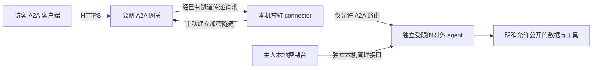

# dsh-a2a 代码与公网接入审查

后续状态：以下是修复前的审查记录。代码修复、兼容性变化和仍需部署验证的部分见 [公网访问修复与迁移](public-access-hardening.md)。

审查日期：2026-10-24。插件提交：`4dcabfb`。本次审查未修改应用源码、未提交代码、未部署公网服务。

结论：入站 A2A 适配层的分层可以保留；本地 agent 通过出站隧道获得稳定公网地址的方向成立。但当前组合尚不适合在个人日常电脑上接待不可信公网访客。先修复权限、资源准入和发布问题，再做邀请制试用。面向公众的产品应把对外执行环境与主人的日常 agent 环境隔开。

## 范围与证据

- 阅读本仓库协议解析、HTTP 路由、身份认证、context/task 生命周期、projection、示例组合、测试、README、升级计划和两份历史记忆。
- 用户最初提供的 `.zcode-session` 路径不存在。通过补充的运行日志，定位到 [原会话的模型交互记录](C:/Users/huangjuhua-desktop/.zcode/cli/rollout/model-io-sess_70cce3f1-a9f0-47c7-93db-d8d9de6e75d8.jsonl)，读取其中 46 条模型请求/响应记录。覆盖 10 月 23 日晚至 24 日上午的保留片段，包含公网访问建议及“帮助用户转接他的 agent”的中继服务讨论；不代表恢复了整个历史会话。
- 为核实部署承诺，附带检查 Talk2MyAgent 的配置生成、URL 生成、监听地址选择及部署指南；这不是对该仓库的完整安全审计。
- 检查本地 DSH 沙箱文档与已安装依赖代码，区分工作目录、写入约束和读取权限。
- `pnpm typecheck`、`pnpm test`（12 文件、176 测试）、`pnpm build` 全部通过。
- 额外使用临时目录和测试模型复现空白名单放行、并发输出混合；使用路由级模拟复现远端 owner 身份接入、本地代理下的 admin 来源判断、超上限准入；使用构建产物及仅声明运行依赖/peer 依赖的临时目录复现缺少 zod。均未调用真实模型。
- 未做真实公网部署、攻击性负载测试、实际个人文件读取或目标客户端互操作认证。下文明确区分实测结果与源码/设计判断。

## 主要发现

### 1. [P1] per-peer cwd 和 read-only 不提供文件读取隔离

位置：[src/index.ts:164](D:/code/dsh-a2a/src/index.ts:164)、[src/index.ts:400](D:/code/dsh-a2a/src/index.ts:400)。部署证据：[DSH 沙箱说明:11](D:/code/deepseek-harness/docs/subsystems/sandbox.zh.md:11)、[Talk2MyAgent 指南:195](D:/code/Talk2MyAgent/docs/guide.md:195)。

插件为不同 peer 设置不同 cwd，并挂载 `standard` preset。对访客只写入 `approval/policy: never`，没有在插件中建立文件读取白名单。配套部署默认的 `read-only` 主要限制文件修改；DSH 文档明确指出网络和进程可见性不在该模式定义内，并说明 Windows ACL 后端存在读取不受限等部分强制执行情形。

因此，在有文件或 shell 工具的生产组合中，不能由“不同 cwd + read-only”推导出“访客读不到主人凭据、其他目录、其他 peer 文件”。跨会话工具按 cwd 检查归属，也不能阻止经普通文件工具读取同一 OS 用户可读的文件。提示词和正则脱敏无法提供这个保证。

证据性质：源码与上游/配套文档一致；没有读取用户真实敏感文件来做攻击验证。现有端到端测试组合没有挂载生产的 standard preset 与完整沙箱链路，176 项测试通过不能证明工具隔离。

修复：公网模式使用专门执行环境，按需挂载可公开的数据副本；不同信任域使用独立容器/VM/OS 身份和凭据。个人 home、完整日常工作区、主人的全部 skills/外部服务凭据不能默认共享。对于可执行 shell 的 agent，环境变量中的密钥仍可能被读取，宜通过权限受限的凭据代理提供能力，并限制访问本机服务和内网的出站网络。沙箱缺失或能力不满足时应拒绝进入公网模式。

### 2. [P1] owner 权限与公网 RPC 共用入口，admin 的本地来源限制在代理后失效

位置：[src/router.ts:236](D:/code/dsh-a2a/src/router.ts:236)、[src/router.ts:253](D:/code/dsh-a2a/src/router.ts:253)、[src/router.ts:761](D:/code/dsh-a2a/src/router.ts:761)、[src/index.ts:439](D:/code/dsh-a2a/src/index.ts:439)。

`serveRpc` 在普通 peer 鉴权前接受 admin token 并设置 `peer = owner`，没有检查连接来源；owner 绕过白名单、请求限流和 context 轮数限制，还会获得 `.hop` 工作区的 workspace-write 模式。声明为本地主人控制用途的凭据由此也能在公网入口使用。

`serveAdmin` 检查 TCP 对端是否本地，但 cloudflared 或本机反向代理转发的公网请求，对后端也显示为本地连接。把整个端口直接映射出去，admin 路径就仍然可从公网到达。

路由级复现：模拟远端地址 `203.0.113.9` 携带测试 owner token 调用 RPC，返回 200 且创建 owner context；同一 token 对 admin 路径在远端地址下返回 403，在本地代理地址下返回 200。

这不是匿名鉴权绕过：仍需有效 admin token。问题在于承诺的“本地管理权限”没有独立于公网访客面的执行边界。

修复：把 owner RPC/admin 移到独立管理监听器或本机 IPC；公网 RPC 仅接受 peer 身份。公网网关和本地 connector 双方都只允许明确的 A2A 路径，拒绝 admin、DSH UI/API 和控制台路径。不能仅靠转发 IP 头解决管理权限分离。

### 3. [P1] 空 trustedPeers 会放行所有已认证访客

位置：[src/router.ts:258](D:/code/dsh-a2a/src/router.ts:258)。调用方：[Talk2MyAgent files.ts:93](D:/code/Talk2MyAgent/packages/a2a-host/src/files.ts:93)。

白名单判断要求 `trustedPeers.length > 0`。配套控制台把勾选的 trusted 访客映射成数组，因此当所有访客都不受信任时，输出 `[]`，反而关闭白名单检查。实测以 `trustedPeers: []` 启动测试组合后，普通访客 SendMessage 返回 200 并被接受。

同时，控制台注释表达的是“所有访客可以聊天，仅 trusted 可以执行任务”，插件实际只有 SendMessage 进入同一 agent 工具集，没有这种权限分层；非空白名单中的未信任访客则连聊天也被整体拒绝。

修复：明确区分 `undefined`（采用默认）与 `[]`（无人获准），或引入显式策略。若产品保留“只聊天”的角色，需要按身份限制可调用工具和数据，不能只改 UI 或 Agent Card 的 skills 声明。

### 4. [P1] maxResidentContexts 是清理目标，不是工作量准入上限

位置：[src/router.ts:352](D:/code/dsh-a2a/src/router.ts:352)、[src/contexts.ts:90](D:/code/dsh-a2a/src/contexts.ts:90)、[src/contexts.ts:121](D:/code/dsh-a2a/src/contexts.ts:121)。

没有 contextId 的请求直接创建 agent，注册表 add 不检查容量；回收器明确跳过忙碌 context。路由级复现中，配置上限为 1，仍创建了 4 个忙碌 context，且可回收数为 0。已有测试也明确接受超过上限的行为。

每分钟限流限制的是请求速率，不能限制累计活任务、模型费用或挂起时间。`blockTimeoutMs` 只是 HTTP 等待期限，超时后任务继续；`maxContextTurns` 数的是访客消息，不是内部模型/tool 步数。

修复：创建 agent 之前原子预留全局和每 peer 并发名额，队列也必须有界；增加真正的任务执行期限、模型/工具调用预算及每日费用配额。拒绝新任务比先接收再回收更可控。无凭据流量在网关另设限流。

### 5. [P1] 发布包遗漏运行依赖 zod

位置：[package.json:84](D:/code/dsh-a2a/package.json:84)、[src/projection.ts:19](D:/code/dsh-a2a/src/projection.ts:19)。

projection 静态导入 zod，但 package.json 只把它列为 devDependency。构建成功后，`lib/projection.js` 仍保留该运行时 import。开发目录恰好安装了它，会掩盖问题。

复现：把构建产物和 package.json 放入临时目录，仅链接声明的 dependencies 与 peerDependencies，导入插件得到 `ERR_MODULE_NOT_FOUND: Cannot find package 'zod' ... lib/projection.js`。宿主若碰巧提升了 zod 可能掩盖问题，但插件不能依赖这种偶然情况。

修复：把 zod 声明为直接运行依赖，并对打包后的插件做无开发依赖的安装加载测试。

### 6. [P2] 同一 context 的并发任务混合输出

位置：[src/index.ts:296](D:/code/dsh-a2a/src/index.ts:296)、[src/index.ts:619](D:/code/dsh-a2a/src/index.ts:619)。

每条 assistant 消息被追加到 activation 内所有尚未结算的 slot；任务又都等整个 agent idle 才结算。实测先阻塞模型，再向同一 context 提交 A、B 两个任务，放行后两个 task 的 artifact 都是 `echo: TASK_A_MARKER\necho: TASK_B_MARKER`。

这次复现是同一个 peer/context 内的任务串答，不是跨 peer 数据泄漏。并发调用者无法可靠地把结果对应回自己的任务。

修复：MVP 可先限制每个 context 同时只有一个任务；若需要并发，建立任务与 turn/消息的明确归属。取消逻辑目前也以整个 agent 为操作对象，需要与任务队列一起设计，并补上取消排队任务、取消当前任务的独立测试。

### 7. [P2] context 驱逐后无法再查询任务，也没有冷恢复路径

位置：[src/index.ts:674](D:/code/dsh-a2a/src/index.ts:674)、[src/router.ts:356](D:/code/dsh-a2a/src/router.ts:356)、[src/router.ts:430](D:/code/dsh-a2a/src/router.ts:430)。

回收器删除 activation；SendMessage 只在当前注册表找 context，GetTask 也只扫描当前 resident activations。即使会话日志仍在，代码没有通过 taskId/contextId 找到它并恢复的路径。因此默认空闲 TTL 结束或容量驱逐后，旧任务会表现为不存在；仅组合持久化服务也不足以恢复查询。

修复：把任务保留期限与 agent 驻留期限分开；持久化 taskId → sessionId → owner 索引，支持读取已驱逐任务及经归属校验的恢复。对公网客户端明确结果保留时间。

### 8. [P2] SSE 断连时没有释放订阅

位置：[src/router.ts:704](D:/code/dsh-a2a/src/router.ts:704)、[src/router.ts:710](D:/code/dsh-a2a/src/router.ts:710)。

stream channel 加入 Set 后，仅在任务结算或服务器拆卸时删除，没有监听 response close/error。任务长时间挂起时，反复 SubscribeToTask 并断连会保留 response、channel 和 settlement 回调。公网中继的网络切换会放大这种情况；代码也没有 SSE heartbeat 与写入背压处理。

修复：断连立即摘除 channel，限制每 peer/task 订阅数量，添加心跳及有界输出缓冲。某个订阅者断线不应默认取消其他订阅者仍等待的任务。

### 9. [P2，配套仓库] 填公网域名时可能发布错误 RPC URL，并继续绑定 LAN

位置：[Talk2MyAgent url.ts:20](D:/code/Talk2MyAgent/packages/a2a-host/src/url.ts:20)、[Talk2MyAgent server.ts:249](D:/code/Talk2MyAgent/packages/a2a-host/src/server.ts:249)。

此前对话建议在“自定义地址”填 `https://a2a.example.com`。实际派生函数对带 scheme 的字符串原样返回，因此 Agent Card 会把根路径作为 RPC 端点，丢失 `/a2a`。同时监听地址选择无法把 HTTPS URL 当本机 IP，会退回 LAN 地址；使用隧道并不会自动变成仅回环监听。

修复：分别配置本地 `bindHost/bindPort` 和外部 `publicRpcUrl`；隧道模式默认监听回环，明确生成和校验完整的 `https://<agent-domain>/a2a`。使用 URL 对象构造路径，覆盖已有路径、末尾斜线、IPv6 和子路径前缀测试。

## 对历史中继方案的判断

“本地执行 + 云端稳定入口 + 本机主动建立出站连接”解决 NAT、动态 IP 和访客安装客户端的问题，这一方向可行。Cloudflare Tunnel 的官方实现也采用出站连接模型：[官方说明](https://developers.cloudflare.com/tunnel/)。

此前讨论里有四处需要修正：

1. **TLS 在 relay 终止，relay 就能读取 Authorization 和正文。** “不记录/不持久化 token”可以是实现策略；“relay 看不到或不接触 token”不是现有架构能提供的保证。本地再次验证 token 也不等于端到端保密。若要求中继不可读，需要额外端到端加密/认证设计，并处理普通 A2A 客户端兼容性。
2. **常驻隧道应由 connector 服务维护。** 配置控制台按需启动并关闭，不适合拥有长连接。关闭 UI 后，connector 和受限执行环境继续运行；电脑睡眠/离线时服务应明确报告不可用。
3. **“几百行、1–2 天”最多说明演示链路。** 多租户路由授权、断线重连、SSE、队列、背压、凭据撤销、配额、观测和升级才决定能否持续服务。不能从自己的 IP 漂移经历直接推出付费需求已得到验证。
4. **Quick Tunnel 不适合本项目完整流式验证。** 官方说明其不支持 SSE、没有可用性保证且域名每次变化；其临时模式无需账号或自有域名，正式稳定接入另行配置。[官方限制](https://developers.cloudflare.com/tunnel/get-started/quick-tunnels/)

## 建议架构

建议一个 agent 分配一个子域名，例如 `agent-123.agents.example.com`。这样 well-known Agent Card 仍在标准根路径；Card 内 RPC 地址固定为该子域名下 `/a2a`，减少多租户子路径发现与重写错误。编号不可预测不能替代授权。

| 层 | 必须承担的职责 |
| --- | --- |
| 云端账户/控制面 | 绑定 tenant、agent、connector；签发范围受限的设备凭据；撤销、暂停、配额；不能由客户端随意声明他人的 agent 路由 |
| 公网网关 | TLS、请求大小/时间/速率限制；只放行 Agent Card GET 和 `/a2a` POST；禁用响应正文和 Authorization 日志，避免缓存任务/流响应 |
| 常驻 connector | 连接目标固定；本地再做路径白名单；重连退避、心跳、连接代际；不接受任意目标 URL/端口以免变成内网代理 |
| A2A 插件 | 独立校验访客身份和 task 归属；执行授权、幂等、并发配额、任务取消/超时/结果保留 |
| 执行环境 | 对外数据可见范围、可调用工具、文件写入和出站网络；用 OS/容器/VM 权限执行，不能靠提示词承诺 |

必须分开三种凭据：云端设备连接凭据、访客 A2A 凭据、主人管理凭据。最后一种不能通过公网网关使用。部署 prompt 和公开 handoff 应按“访客可能要求复述全文”来准备，不能混入私密工作记忆。

MVP 优先支持异步提交与 GetTask 查询，减少中间代理对长时间阻塞请求的影响；支持 SSE 时需贯通心跳、关闭传播与背压。当前服务每次发送都会生成新 task，未按外部 messageId 去重，中继不能在断线后盲目重放 SendMessage。需定义按 tenant/peer/messageId 的幂等记录及内容冲突处理；没拿到响应应表达“结果未知”，不能伪装成确定未执行。

本机离线时先返回明确的 503/离线状态；在持久化、过期和重复执行规则落地前，不提供无限离线排队。中继解决可达性，不会让关机的本地 agent 继续工作。

A2A 官方部署指南要求生产 HTTPS，并把细粒度授权和最小权限留给应用实施；协议接通不是工具访问获准的证明：[官方指南](https://a2a-protocol.org/latest/topics/enterprise-ready/)。

## 推进顺序

1. 修复 P1 问题和 context 并发串答；补齐生产 preset、文件读取边界、owner 公网拒绝、全未信任访客、并发配额和净安装测试。
2. 在独立执行环境中做少量邀请制公网试用，只开放少数明确工具和公开数据。验收关闭 UI、切换网络、token 撤销、任务超时、SSE 断线和代理故障后的行为。
3. 把账号、设备绑定、访客发放、在线状态和审计接入 Talk2MyAgent。第一版优先评估成熟隧道作为传输基础；现有 [Tunnels for Platforms](https://developers.cloudflare.com/tunnel/features/tunnels-for-platforms/) 官方就包含按客户连接 agent 的场景，是否采用还需验证目标网络质量、费用和部署要求。
4. 只有当成熟隧道在控制能力、网络覆盖或成本上不能满足需求时，再自研数据传输层。先验证用户是否愿意持续公开某项 agent 能力、是否愿意邀请他人使用，以及权限设置是否足够清楚；通讯录和公开发现可以后置。

上线验收应以这些结果为准：远程 owner/admin 全拒绝；越权读取和本机服务访问被执行环境阻止；空白名单不执行；超额任务在创建 agent 前被拒绝；任务输出不串答；断线无重复执行；旧 task 在承诺保留期内可查；运行依赖干净安装成功。
